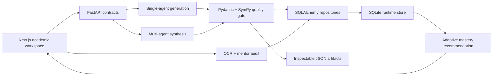

# Calculus Atelier Interview Guide

## 30-second introduction

Calculus Atelier is an adaptive calculus learning system rather than a thin LLM chat
wrapper. It generates structured exercises, audits typed or handwritten
solutions, tracks topic mastery, and recommends the next task. The core
engineering decision is to separate probabilistic generation and pedagogical
review from deterministic schema and symbolic mathematics validation.

## Architecture story

The database models users, per-topic mastery, immutable learning events,
problems, submissions, and generation runs. Repository methods define short
transaction boundaries, while WAL mode and a busy timeout make local concurrent
writes safer.

## Demonstration flow

1. Start the API and frontend.
2. Log in with a new local learner ID.
3. Generate a manually selected problem and explain that manual settings are
   not overridden by adaptive recommendations.
4. Submit an answer and show tutor feedback plus the dashboard update.
5. Open `/docs` to demonstrate validated request contracts and stable errors.
6. Run `python migrate_json_to_sqlite.py` a second time to show idempotency.
7. Run `python evaluate_system.py` and discuss the generated report.
8. Optionally call `/synthesize/stream` to show observable agent collaboration.

## Evidence currently produced by the project

- 28 automated backend tests cover schemas, authentication, ownership,
  database upgrades, symbolic validation, quality gates,
  API contracts, repositories, migration idempotency, and benchmark stability.
- A Playwright test covers registration, session restoration, generation,
  auditing, progress recording, and dashboard navigation in real Chrome.
- The local legacy migration imported 8 learner profiles, 302 unique problems,
  and 186 historical generation runs.
- The current offline corpus comparison reports 21.1% schema validity for 218
  legacy single-agent artifacts versus 100% for 10 multi-agent artifacts.
- Integration-analysis coverage is 5.05% versus 100%, and duplicate rate is
  0.92% versus 0%.

These figures are evidence of the validation pipeline's effect, not a claim
that the multi-agent approach is universally superior. Its current sample is
small and covers one topic, while the single-agent set spans 23 topics.

## Design decisions worth defending

### Why SQLite instead of keeping JSON

JSON is excellent for inspecting generated educational content but weak for
concurrent progress updates, querying history, and maintaining relationships.
SQLite keeps deployment simple for a portfolio project while demonstrating
real transactions and a repository boundary that can later target PostgreSQL.

### Why keep JSON at all

Generated artifacts remain easy to review, diff, export, and use as benchmark
inputs. The migration is additive and idempotent, so the persistence upgrade is
reversible at the data-source level.

### Why not trust an LLM reviewer

The reviewer judges pedagogy and presentation. Pydantic checks structural
contracts, and SymPy checks explicit mathematical equivalence. A failed
deterministic check cannot be overridden by a friendly language-model verdict.

### Why single-agent online and multi-agent offline

Interactive practice prioritizes latency. Dataset curation prioritizes quality,
traceability, and role specialization. Keeping those paths separate avoids
making every learner wait for a multi-agent conversation.

### What to improve next

Next improvements are Secure HttpOnly cookie deployment, rate limiting,
automated symbolic-claim extraction for legacy content, and executing the full
300-pair A/B manifest with a controlled model budget.
